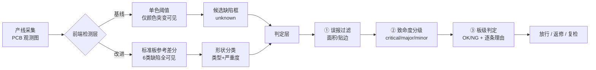
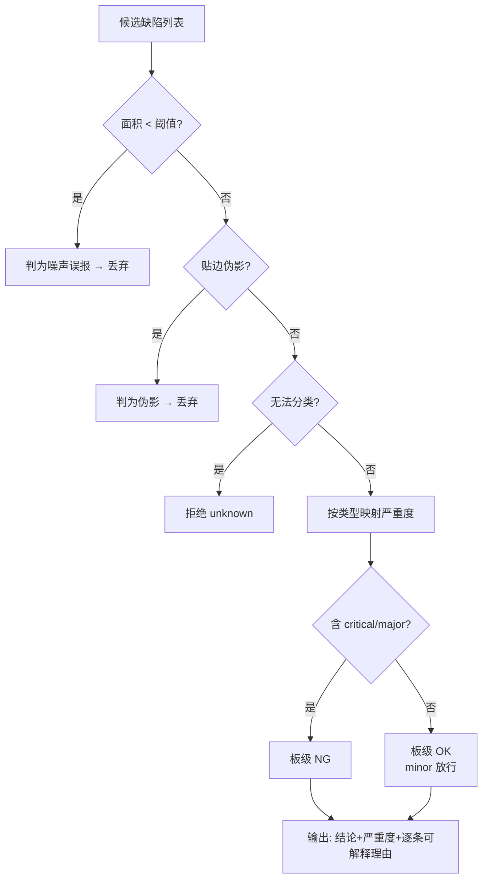

# 系统流程图与答辩讲述顺序

## 1. 系统主流程（对齐答辩 0:50–1:50「解决方案与核心创新点」）

## 2. 判定层内部（核心创新点，重点讲）

## 3. 实验流程（对齐 1:50–3:50「数据、方法、实验设计」）

## 4. 7 分钟陈述建议（严格对齐通知第七部分时间分配）

| 时间 | 讲什么 | 同步出示（通知要求） |
|---|---|---|
| 0:00–0:50 | PCB 产线「漏检 + 过杀」的真实难题，漏检代价 | 问题背景说明 |
| 0:50–1:50 | 三层架构图；强调创新在判定层，不是 YOLO 本身 | 系统流程图 + 基线对照 |
| 1:50–3:50 | 140 块合成板、6 类缺陷、IoU 口径与公平性 | 数据构成、指标定义 |
| 3:50–5:30 | 三档对照表 + 三张图；讲 hard 档失败边界 | 结果图、表（fig1/2/3） |
| 5:30–6:30 | 现场演示：生成缺陷 → 检测 → 五视图 → 判定理由 | 应用程序实跑 |
| 6:30–7:00 | 价值：误判 71.4%→1.4%；本人贡献；下一步接真实数据 | 代码/流程、README |
| 7:00–10:00 | 评委问答，回指 README 与 results.json 证据 | 全部材料 |

## 5. 关键话术（应对「这不就是用了 AI 吗？」）

> 评委若质疑「用了 YOLO/AI 不算创新」——
> 本项目**刻意不依赖任何深度学习权重**，用零依赖的参考差分做前端。真正的创新是把「检测框」转化为「按 IPC 严重度的放行决策」：
> （1）参考差分解决了基线对缺口型缺陷 50% 的结构性漏检；
> （2）判定层把 minor 缺陷从「一律 NG」改为「按严重度放行」，板级误判从 100 块降到 2 块；
> （3）输出逐条可解释理由，让质检员能追溯每一个判定。
> 这三步都有独立对照数据（见 results.json），不是「跑了个模型」。
